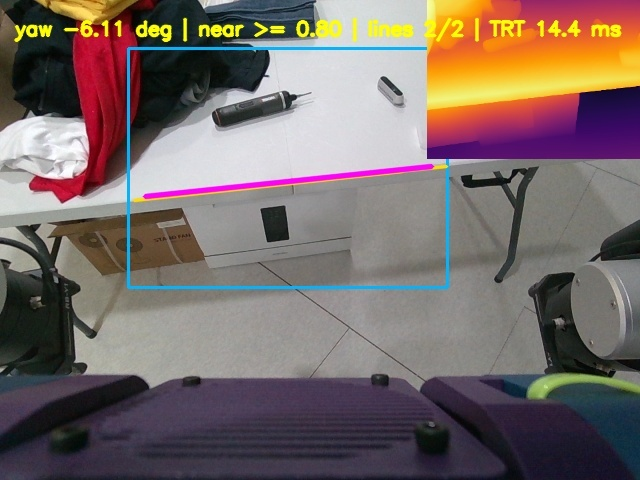

<div align="center">
  <h1> CAFM — Geometry-Based Final Approach and Alignment for Mobile Manipulation </h1>
  
  
  
</div>


**A Ros2 package for aligning a robot base to a manipulation-ready pose after navigation**


# Overview
Navigation stacks such as Nav2 can move a robot near a target, but reaching a navigation goal ***doesn't guarantee a interaction between robot and human***; Residual errors in distance or heading can prevent the robot arm from reaching an object or lead to an unstable manipulation pose. 

This project is a ROS2 package for the final approach and alignment stage after navigation. It processes point clouds from a depth camera and LiDAR to estimate target geometry, then aligns the robot base to a configurable distance and heading.

During the approach, the robot's trajectory is recorded int the `odom` frame. Because of the unstability of rotation from final goal pose. 

# Demonstration

<div align="center">
  
  
</div>

# System Arcitecture
<div align="center">
  
</div>

| Node | Responsibility |
|---|---|
| `pc_detector_node` | Processes depth-camera point clouds to estimate target distance and publish debug clouds and markers. |
| `lidar_x_detector_node` | Provides LiDAR-based distance estimation as a fallback and safety input. |
| `edge_detector_node` | Estimates heading error from camera-image edges. |
| `approach_manager_node` | Provides the `/approach` action server, manages the approach state machine, and selects perception results for control. |
| `approach_controller_node` | Converts the control error into velocity commands published on `/cmd_vel`. |
| `approach_debug_logger_node` | Records per-action CSV files, debug images, and point clouds. |

# Key Components
## 1. Point Cloud and LiDAR Perception

The perception pipeline filters the depth-camera point cloud using a spatial ROI and robot self-filtering, then estimates the target distance from the nearest surface. A LiDAR-based detector provides a fallback and safety input when camera-based distance measurements are unavailable or less reliable.

<div align="center">
  
</div>

## 2. Approach Management and Control

`approach_manager_node` provides the `/approach` action server and manages the approach state machine. It selects and combines perception results to generate the control error. `approach_controller_node` converts this error into velocity commands using PID control with acceleration and deceleration limits.

## 3. Edge Alignment and Trail-Based Retreat

`edge_detector_node` estimates heading error from image edges. For depth-aware edge detection, `depth_edge_detector_node` can use relative depth from Depth Anything V2 to select nearby image edges. During approach, the robot's path is recorded in the `odom` frame; `retreat_node` can follow this trail in reverse.

# Requirements and Build
- ROS2 Jazzy
- C++ 17
- Eigen3, OpenCV and PCL
- Ros2 message, action, and TF dependencies listed in `package.xml`
- This project depends on inha_interfaces, a custom ROS 2 interface package used for communication between system components. The interface definitions are not included in this repository and must be provided separately.

```
mkdir -p approach_ws/src
cd ~/approach_ws/src
git clone https://github.com/PGW63/CAFM.git

cd ~/approach_ws
rosdep install --from-paths src --ignore-src -r -y
colcon build --symlink-install --packages-up-to cafm
source install/setup.bash
```

### Depth Anything V2

Depth Anything V2 is required only for the depth-aware edge detector.
The standard image-based edge detector does not require this model.

Download the ONNX model from the
[Depth Anything V2 Small release](https://github.com/PGW63/CAFM/releases/download/Depth-Anyting-v2-small-onnx/depth_anything_v2_vits.onnx):

```bash
cd ~/approach_ws/src/CAFM
mkdir -p models
wget -O models/depth_anything_v2_vits.onnx \
  https://github.com/PGW63/CAFM/releases/download/Depth-Anyting-v2-small-onnx/depth_anything_v2_vits.onnx
```
Build the TensorRT engine on the target robot:
```
python3 tools/export_depth_anything_v2_engine.py \
  --reuse-onnx \
  --onnx models/depth_anything_v2_vits.onnx \
  --engine models/depth_anything_v2_vits.engine
```
After generating the engine, rebuild the package:
```
cd ~/approach_ws
colcon build --symlink-install --packages-up-to close_approach
source install/setup.bash
```
## Run

Source the workspace in each terminal:
```
cd ~/approach_ws
source install/setup.bash
```

### main approach pipeline
This launch starts the point-cloud detector, LiDAR detector, image-edge detector, approach manager, controller, and debug logger.

```
ros2 launch close_approach approach.launch.py
```

Send an approach goal from another terminal:
```
ros2 action send_goal /approach \
  inha_interfaces/action/Approach \
  "{goal_distance: 0.30}" --feedback
```

### Depth-aware edge detection
To user Depth Anything v2, first download the ONNX model, build the TensorRT engine, and rebuild the package as described in **Requirements and Build**

```
ros2 launch close_approach approach_depth_edge.launch.py
```

### Retreat
Start `retreat_node` in a separate terminal. After an approach has published `/approach/trail`, send a goal to the retreat action:
```
ros2 run close_approach retreat_node
```

```
ros2 action send_goal /retreat \
  inha_interfaces/action/Retreat "{}"
```

# Evaluation
This project achieved a **96% success rate** across five different environments and 10 target types: round table, chair, rectangular table, washing machine, bookshelf, sofa, bed, person, and two decorative objects.

# Limitations
- **Robot-specific dependencies**: The action interfaces come from `inha_interfaces`, and sensor topics and TF frames must match the target robot.

- **Debug path**: Debug files are written under `/home/thor/inha_logs/module/` by default.

- **Unusual object geometry**: The success rate may drop significantly for objects whose shapes make reliable geometric feature extraction difficult.

