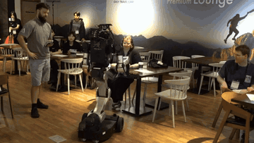
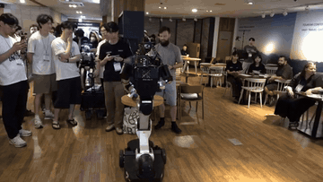
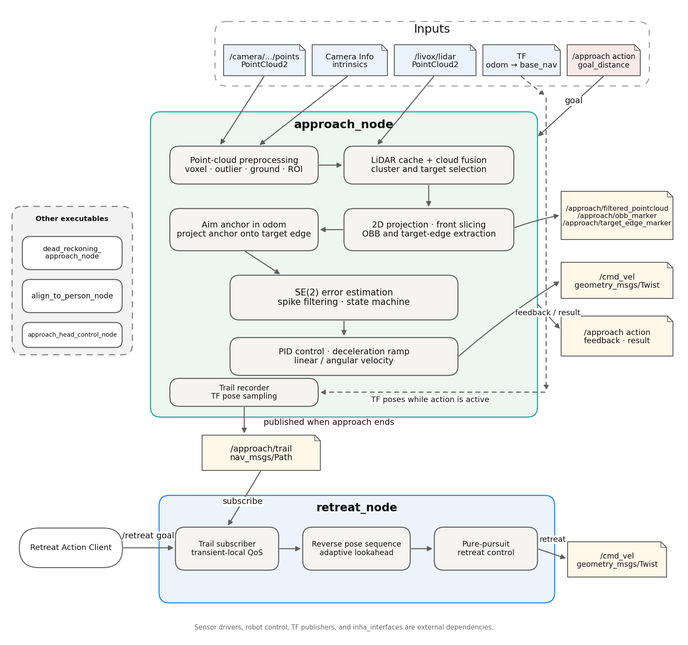

<div align="center">
  <h1> CAFM — Geometry-Based Final Approach and Alignment for Mobile Manipulation </h1>
  
  
  
</div>


**A Ros2 package for aligning a robot base to a manipulation-ready pose after navigation**


# Overview
Navigation stacks suchas Nav2 can move a robot near a target, but reaching a navigation goal ***doesn't guarantee a interaction between robot and human***; Residual errors in distance or heading can prevent the robot arm from reaching an object or lead to an unstable manipulation pose. 

This project is a ROS2 package for the final approach and alignment stage after navigation. It processes point clouds from a depth camera and LiDAR to estimate target geometry, then aligns the robot base to a configurable distance and heading.

During the approach, the robot's trajectory is recorded int the 'odom' frame. Because of the unstability of rotation from final goal pose. 

# Demonstration

<div align="center">
  
  
</div>

# System Arcitecture
<div align="center">
  
</div>

|Node|Respnsibility|
|---|---|
|`approach_node`|Main approach action server. Processes camera and LiDAR point clouds, estimates target geometry, and controls `/cmd_vel`|
|`retreat_node`|Restreat action server. Follows the recorded approach trail in reverse.|
|`dead_reckoning_approach_node`|Short-distance approach action server using odometry and a requested travel distance.|

# Key Components
## 1. Point Cloud Perception
Preprocesses and combines and LiDAR point clouds, select the target cluster, and extracts its oriented bounding box and approach edge with Depth Estimation.

<div align="center">
  
</div>

## 2. Close Approach control
Estimates the relative pose error, maintains an aim anchor, filters outliers, and controls the base during approach and heading alignment.

## 3. Trail-Based Retreat
Records the robot's approach path and follows it in reverse to guide the robot back toward its starting position.

# Requirements and Build
- ROS2 Jazzy
- C++ 17
- Eigen3, OpenCV and PCL
- Ros2 message, action, and TF dependencies listed in `package.xml`
- This project depends on inha_interfaces, a custom ROS 2 interface package used for communication between system components. The interface definitions are not included in this repository and must be provided separately.

```
mkdir -p approach_ws/src
cd ~/approach_ws/src
git clone https://github.com/PGW63/CAFM.git

cd ~/approach_ws
rosdep install --from-paths src --ignore-src -r -y
colcon build --symlink-install --packages-up-to cafm
source install/setup.bash
```

## Run

### Main approach node
```
ros2 run cafm approach_node
```
The node provides an approach action using inha_interfaces/action/Approach. The goal_distance field sets the requested standoff distance:
```
ros2 action send_goal /approach inha_interfaces/action/Approach \
  "{goal_distance: 0.30}"
```
Check the installed action definition for the exact goal, feedback, and result fields:
```
ros2 interface show inha_interfaces/action/Approach
```
### Retreat node
Run the retreat node in a separate terminal:
```
ros2 run cafm retreat_node
```

After an approach has completed and published /approach/trail, send a goal to the retreat action:
```
ros2 action send_goal /retreat inha_interfaces/action/Retreat "{}"
```
# Evaluation
This project achieved a **96% success rate** across five different environments and 10 target types: round table, chair, rectangular table, washing machine, bookshelf, sofa, bed, person, and two decorative objects.

# Limitations
- **Robot-specific dependencies**: The action interfaces come from `inha_interfaces`, and sensor topics and TF frames must match the target robot.

- **Debug path**: Debug files are written under `/home/thor/inha_logs/module/` by default.

- **No launch file**: Nodes and their dependencies must currently be started separately.

- **Unusual object geometry**: The success rate may drop significantly for objects whose shapes make reliable geometric feature extraction difficult.


